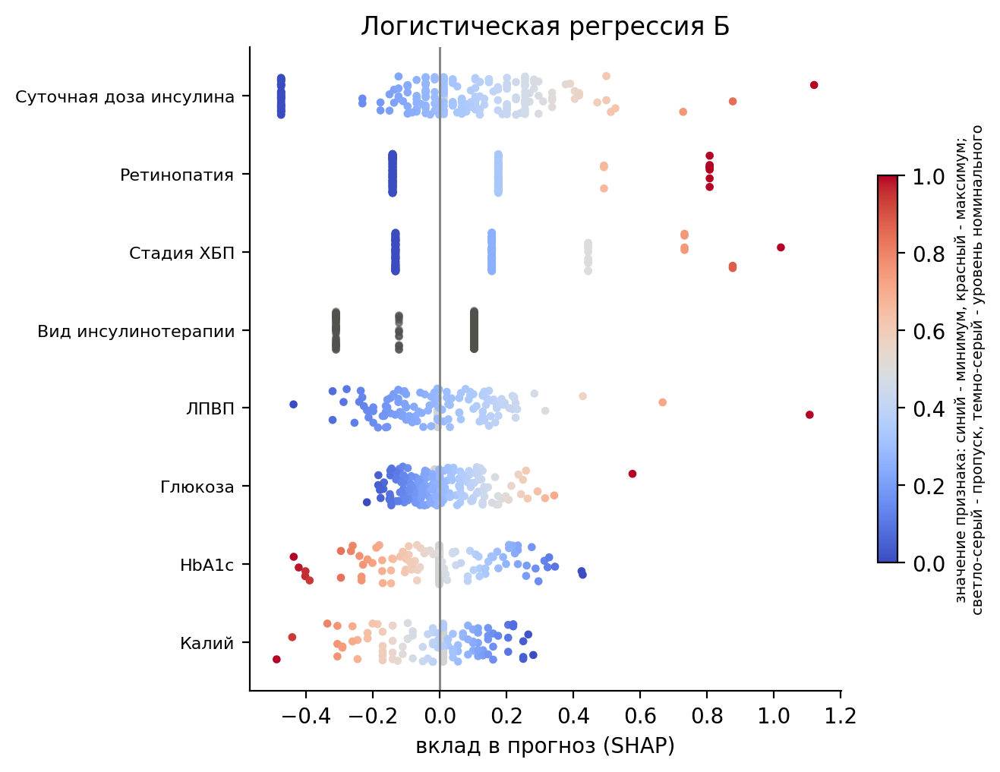

# Клинические факторы рецидивирующего течения диабетического кетоацидоза

*Clinical factors of recurrent diabetic ketoacidosis: statistics and interpretable machine learning on a Russian cohort*


Код исследования: какие клинические показатели при поступлении отличают
рецидивирующее течение диабетического кетоацидоза (ДКА) от единичного эпизода.
Факторы выявляются двумя независимыми путями, классической статистикой по
фиксированному протоколу и методом SHAP поверх интерпретируемых моделей
машинного обучения, после чего результаты сопоставляются.

## Аннотация

**Цель.** Выявить клинические факторы, связанные с рецидивирующим течением
диабетического кетоацидоза (ДКА), на российской когорте и оценить методами
интерпретируемого машинного обучения, насколько эти группы различаются по
клиническому профилю при поступлении и какие сочетания признаков их разделяют.

**Методы.** Ретроспективное одноцентровое исследование: предикторы и исход
относятся к одной госпитализации, времени до события в данных нет, поэтому
модель диагностическая, а не прогностическая на временном горизонте. Исход
установлен у 287 пациентов (рецидивирующее течение 89, единичный эпизод 198).
Группы сравнивали по фиксированному статистическому протоколу. Логистическую
регрессию обучали на 24 признаках без мультиколлинеарности и на наборе,
полученном голосованием пяти методов отбора признаков, случайный лес и
CatBoost - на всех 24 признаках. Отложенный тест (58 пациентов) отделили до
всей предобработки, гиперпараметры и отбор признаков выполняли во вложенной
кросс-валидации. Вклад признаков оценивали методом SHAP, совместные эффекты -
взаимодействиями SHAP и одиночным деревом решений, результаты сопоставляли с
классической статистикой. Заранее задана одна гипотеза - о связи приема
алкоголя с рецидивирующим течением.

**Результаты.** Рецидивирующее течение отличалось большей длительностью
сахарного диабета, медиана 9 против 6 лет, большей суточной дозой инсулина, 43
против 32 ед., более высоким ЛПВП и более низким HbA1c, 11.0 против 12.2%. В
группе рецидива чаще встречались хроническая болезнь почек, ретинопатия и
полинейропатия. Гипотеза о связи с алкоголем подтвердилась: прием алкоголя за
сутки до ДКА повышал шансы рецидивирующего течения, ОШ 2.10 при 95% ДИ
1.15-3.83. Модели различали группы умеренно и близко между собой, ROC-AUC по
вложенной кросс-валидации 0.68-0.70 с перекрывающимися доверительными
интервалами. На отложенном тесте логистическая регрессия на отобранных
признаках дала ROC-AUC 0.799 (0.669-0.915), CatBoost 0.662 (0.516-0.805).
По SHAP все модели ставили первой суточную дозу инсулина, устойчивое ядро
дополняли вид инсулинотерапии, стадия ХБП и ретинопатия. Совместные эффекты
признаков оказались слабыми: одиночное дерево решений при подборе выбирало
глубину 2 и различало группы хуже ансамблей, ROC-AUC 0.637.

**Заключение.** На российской когорте из 287 пациентов рецидивирующее течение
ДКА связано с большей длительностью диабета, большей суточной дозой инсулина,
приемом алкоголя, а также с почечными и микрососудистыми осложнениями.
Интерпретируемые модели различают группы умеренно, ROC-AUC около 0.7, и
ансамбли деревьев не превосходят логистическую регрессию. Скромные метрики и
данные одного центра требуют проверки на внешних данных до клинического
применения.

## Основные результаты

| Модель | ROC-AUC, вложенная CV (95% ДИ) | ROC-AUC, тест (95% ДИ) |
|---|---|---|
| Логистическая регрессия Б (8 признаков) | 0.700 (0.633-0.764) | 0.799 (0.669-0.915) |
| CatBoost (24 признака) | 0.681 (0.621-0.743) | 0.662 (0.516-0.805) |
| Случайный лес (24 признака) | 0.685 (0.622-0.746) | - |
| Логистическая регрессия А (24 признака) | 0.678 (0.606-0.746) | - |

Тест (58 пациентов, 18 рецидивов) открыт один раз, после заморозки моделей и
порогов. На тест пошли две модели разных классов, остальные использованы для
сравнения и интерпретации.



## Данные

Данные пациентов закрыты и в репозиторий не входят: сырой датасет,
промежуточные файлы, таблицы результатов и обученные модели исключены через
`.gitignore`. Ноутбук хранится без выводов, поскольку они содержат таблицы и
рисунки на данных пациентов. Доступ к данным возможен по обоснованному запросу к
автору для переписки в рамках этических ограничений.

Когорта: 303 записи, исход установлен у 287 пациентов, 24 признака (15
количественных, 3 бинарных, 4 порядковых, 2 номинальных). Разбиение на
обучающую (229) и тестовую (58) части стратифицированное, состав теста
закреплен списком `config.TEST_IDS`.

## Структура репозитория

```
src/
  config.py        пути, зерно, роли колонок, исключенные признаки с причинами
  data.py          загрузка и приведение типов, матрица признаков и исход
  eda.py           разведочный анализ: словарь колонок, VIF, графики
  stats.py         статистика по протоколу: две и три группы, описание выборки
  evaluate.py      сплит, единая схема оценки (повторная CV, OOF, бутстрэп-ДИ,
                   калибровка, рабочие точки, кривые принятия решений)
  structure.py     импутация, пропуск против исхода, PCA, t-SNE, k-means
  models.py        фабрики моделей: логистическая регрессия, SMOTENC, деревья
  screening.py     одномерная разделяющая сила признаков
  selection.py     пять методов отбора признаков для логрега и голосование
  tuning.py        подбор Optuna во вложенной CV, кэш, аудит подбора
  importance.py    SHAP и встроенные меры, устойчивость топа признаков
  interactions.py  взаимодействия SHAP, дерево решений
  thresholds.py    пороги признаков по индексу Юдена
  synthetic.py     генераторы синтетики и их оценка
  finalist.py      заморозка моделей до теста и сверка с записью
notebooks/
  pipeline.ipynb   сквозной ноутбук: шаги 0-11 и приложения
paper/
  make_figures.py  рисунки статьи
  fig1_shap_logreg_b.png, fig2_shap_catboost.png
```

## Пайплайн

Ноутбук `notebooks/pipeline.ipynb` выполняется сверху вниз, каждый шаг
заканчивается выводом с числами.

| Шаг | Содержание |
|---|---|
| 0 | Данные и разведочный анализ, исключение линейно зависимых признаков |
| 1 | Статистика по протоколу: рецидив против единичного эпизода, степень тяжести |
| 2 | Схема валидации: 5 повторов стратифицированной 5-фолдовой CV, OOF, бутстрэп-ДИ |
| 3 | Точка отсчета: логистическая регрессия по умолчанию |
| 4 | Пропуски: медиана, KNN, MICE; структура данных |
| 5 | Дисбаланс классов: без балансировки, веса, SMOTENC |
| 6 | Логистическая регрессия А: L2, сила штрафа по log loss |
| 7 | Логистическая регрессия Б: пять методов отбора признаков и голосование |
| 8 | CatBoost, случайный лес, LightGBM: Optuna во вложенной CV |
| 9 | Сравнение моделей, финальные конфигурации, пороги F1 и F2 |
| 10 | Интерпретация: SHAP, устойчивость, взаимодействия, дерево решений |
| 11 | Отложенный тест, открытый один раз после заморозки моделей |
| А, Б | TabPFN v2 и генеративная синтетика (в статью не входят) |

## Воспроизведение

```bash
conda env create -f environment.yml
conda activate dka
```

`torch` ставится в версии для процессора:

```bash
pip install torch==2.14.0 --index-url https://download.pytorch.org/whl/cpu
```

Файл данных кладется в `data/raw/` под именем, заданным в `config.RAW_DATASET`.
Затем ноутбук выполняется целиком:

```bash
jupyter nbconvert --to notebook --execute --inplace --ExecutePreprocessor.timeout=7200 notebooks/pipeline.ipynb
```

Первый прогон самый долгий: подбор Optuna для деревьев занимает около часа. Его
результаты кэшируются в `data/interim/step8` и при тех же данных и настройках
читаются с диска, тогда повторный прогон занимает около 40 минут. Рисунки статьи строит
`python paper/make_figures.py` после прогона ноутбука.

Воспроизводимость: зерно одно на проект (`config.RANDOM_SEED = 0`), версии
библиотек закреплены в `requirements.txt`, модели для теста заморожены в
записи с отпечатком данных, и при повторном прогоне запись сверяется.

## Методология

- Без утечек данных: разбиение на обучающую и тестовую части один раз до любой
  предобработки, импутация, масштабирование, отбор признаков и синтетика
  обучаются только внутри фолдов.
- Вложенная кросс-валидация для подбора гиперпараметров и отбора признаков,
  модели сравниваются по перекрытию 95% ДИ ROC-AUC, при перекрытии
  предпочтение более простой модели.
- Метрики под клинику и дисбаланс: ROC-AUC и PR-AUC с бутстрэп-ДИ, калибровка
  (наклон, калибровка в среднем, масштабированный индекс Бриера), матрица
  ошибок, чувствительность, специфичность, PPV, NPV, кривые принятия решений.
  Accuracy не используется.
- Статистика по протоколу медицинского статистика: выбор критерия по
  нормальности и равенству дисперсий, отношение шансов с 95% ДИ.
- Отчетность по STROBE и TRIPOD+AI.

## Статья

Рукопись подготовлена к подаче, ее аннотация приведена выше. Ссылка на
публикацию будет добавлена после выхода статьи.

## Авторы

- Олег Садыхов, Университет ИТМО (ovelsad@niuitmo.ru)
- Василий Леоненко, Университет ИТМО

## Лицензия

Код распространяется по лицензии MIT, см. [LICENSE](LICENSE). Генераторы
синтетики SDV (приложение Б) распространяются по лицензии BUSL-1.1.
